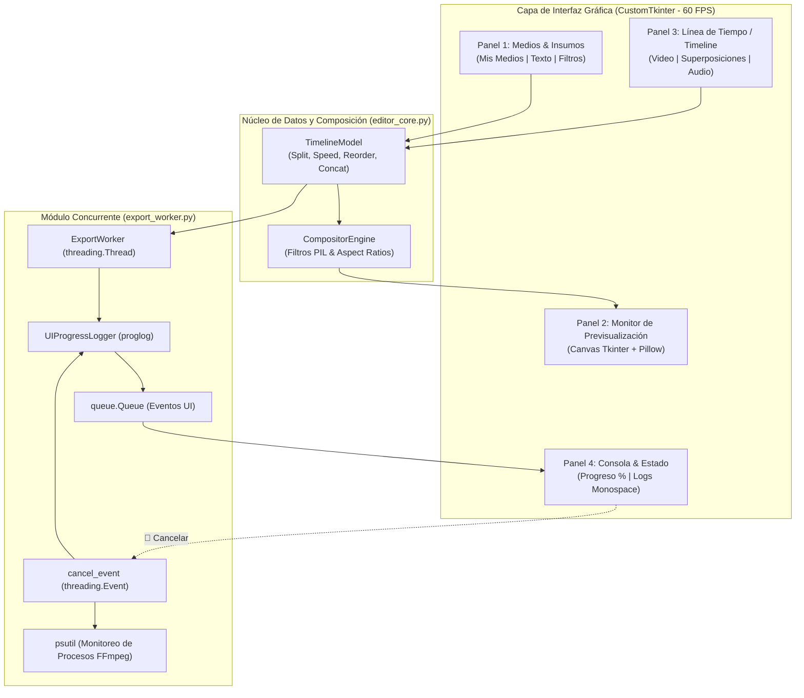

# 🎬 Editor y Procesador de Video Pro
### *Arquitectura estilo CapCut con Interfaz Gráfica Moderna en Modo Oscuro (CustomTkinter)*

---

## 🌟 Descripción General

**Editor y Procesador de Video Pro** es una aplicación de escritorio local de edición audiovisual profesional desarrollada en **Python**. Su diseño está inspirado en la experiencia de usuario y arquitectura de **CapCut**, presentando una interfaz gráfica moderna en **Modo Oscuro ("Dark")**, previsualización adaptativa en tiempo real y un motor de procesamiento concurrente multi-hilo basado en **MoviePy 2.x**, **Pillow** y **FFmpeg**.

La aplicación está diseñada para creadores de contenido digital, soportando formatos horizontales para YouTube (16:9), formatos verticales para TikTok, Instagram Reels y YouTube Shorts (9:16), así como formatos cuadrados (1:1).

---

## 🏗️ Arquitectura del Sistema



---

## 🚀 Características Principales

### 1. Panel 1: Medios e Insumos (Arriba a la izquierda)
- **Mis Medios:**
  - Importación multi-formato: Videos (`.mp4`, `.mov`, `.avi`, `.mkv`, `.webm`), Audios (`.mp3`, `.wav`, `.aac`, `.m4a`) e Imágenes (`.png`, `.jpg`, `.webp`).
  - Tarjetas de medios con generación automática de miniaturas en memoria y metadatos (resolución, duración, tipo).
  - Filtros rápidos por categoría: *Todos*, *Videos*, *Audios*, *Imágenes*.
  - Botón integrado **⚡ Generar Clips Demo** para crear medios de prueba sintetizados al instante.
- **Texto / Superposición:**
  - Generador dinámico de subtítulos, títulos y marcas de agua.
  - Opciones de tamaño (16px a 72px), colores vivos con canal alfa, alineaciones (*Inferior*, *Centro*, *Superior*, *Marcas de agua en esquinas*) y cajas translúcidas redondeadas.
- **Filtros / Ajustes:**
  - Modificación en tiempo real del clip seleccionado en la línea de tiempo.
  - Sliders de **Brillo** (-50% a +50%), **Contraste** (0.5x a 2.0x) y **Saturación** (0.0x a 2.0x).
  - Presets de estilo: *Normal*, *Blanco y Negro (B&W)*, *Sepia Vintage* e *Invertir Colores*.
  - Transformaciones geométricas: *Espejo horizontal (Flip H)* y *Rotación (0°, 90°, 180°, 270°)*.
  - Control de volumen del clip (0% a 200%) y switch para *Silenciar Clip*.

### 2. Panel 2: Monitor de Previsualización (Arriba a la derecha)
- Reproductor visual de alto rendimiento basado en `Tkinter Canvas` y `Pillow`.
- Selector dinámico de relación de aspecto:
  - **16:9 Horizontal:** YouTube, PC, TV.
  - **9:16 Vertical:** TikTok, Instagram Reels, YouTube Shorts.
  - **1:1 Cuadrado:** Instagram Feed.
- Controles de transporte completos: `Play / Pausa`, avanzar y retroceder por 1s y 5s, y seekbar interactiva sincronizada con tiempo exacto (`00:00.00 / 00:00.00`).

### 3. Panel 3: Línea de Tiempo / Timeline (Zona inferior)
- **Visualización de pistas apiladas:**
  - 🎥 **Pista de Video Principal** (borde y acento cian `#00D2C4`).
  - 🔤 **Pista de Superposición / Logo / Títulos** (borde y acento púrpura `#7B61FF`).
  - 🎵 **Pista de Audio Secundario / Música** (borde y acento verde `#00E676`).
- **Barra de herramientas rápida:**
  - ✂️ **Dividir (Split):** Corta el clip seleccionado exactamente en la posición del cabezal de tiempo.
  - 🗑️ **Eliminar Clip:** Suprime el clip seleccionado y reajusta automáticamente la pista.
  - ⚡ **Velocidad:** Modifica la velocidad del clip (0.5x, 0.75x, 1.0x, 1.5x, 2.0x) recalculando su duración.
  - 🔀 **Reordenar (◀ / ▶):** Intercambia el orden secuencial de los clips de video.
  - 🔗 **Unir Clips:** Abre el Gestor de Concatenación con contenedor deslizable (`CTkScrollableFrame`) para organizar y ensamblar clips.

### 4. Panel 4: Consola y Panel de Exportación (Zona inferior extrema)
- Barra de progreso (`CTkProgressBar`) con indicador numérico en vivo: `Porcentaje % | Cuadro actual/total | FPS | Tiempo restante estimado (ETA)`.
- Consola de registros monospace (`#0A0A0C`) con marcas de tiempo `[HH:MM:SS]` y colores sintácticos para `[INFO]`, `[SUCCESS]`, `[WARNING]`, `[ERROR]` y `[RENDER]`.
- Botones para limpiar consola y exportar los registros a un archivo de texto `.txt`.

### 5. Concurrencia y Cancelación Inmediata
- La exportación se ejecuta en un hilo secundario (`threading.Thread`) para garantizar que la interfaz gráfica permanezca completamente fluida a **60 FPS** sin congelamientos ni caídas de fotogramas.
- El botón **🛑 Cancelar Exportación** activa un `threading.Event` que:
  1. Interrumpe de inmediato el bucle de renderizado de MoviePy mediante una excepción personalizada en el logger.
  2. Identifica y termina los subprocesos huérfanos de FFmpeg utilizando `psutil`.
  3. Elimina automáticamente los archivos temporales e incompletos en disco, evitando archivos corruptos.

---

## 📁 Estructura del Proyecto

```text
video_editor_pro/
│
├── main.py              # Punto de entrada principal y orquestador de interfaz gráfica
├── editor_core.py       # Modelo de datos (MediaAsset, TimelineModel) y motor de composición
├── export_worker.py     # Hilo de renderizado, logger de progreso y cancelación segura
├── ui_components.py     # Componentes visuales (Monitor, Timeline, Modales de Concat y Export)
├── demo_generator.py    # Generador de medios de muestra sintetizados (clips neon, audio)
├── requirements.txt     # Dependencias del proyecto
└── README.md            # Especificaciones técnicas y guía de usuario
```

---

## ⚙️ Requisitos e Instalación

### Requisitos del Sistema:
- **Python:** 3.10 o superior (recomendado Python 3.12).
- **Sistema Operativo:** Windows 10/11, macOS o Linux.

### Instalación de dependencias:
Abre una terminal en el directorio del proyecto y ejecuta:

```bash
pip install -r requirements.txt
```

*Contenido de `requirements.txt`:*
- `customtkinter>=6.0.0`
- `moviepy>=2.0.0`
- `Pillow>=10.0.0`
- `psutil>=5.9.0`
- `numpy>=1.25.0`
- `proglog>=0.1.10`

---

## 🎮 Guía de Ejecución

Para iniciar la aplicación:

```bash
python main.py
```

### ⌨️ Atajos de Teclado Rápidos:
| Atajo | Acción |
| :--- | :--- |
| <kbd>Espacio</kbd> | Reproducir / Pausar monitor |
| <kbd>Supr</kbd> / <kbd>Delete</kbd> | Eliminar clip seleccionado en la línea de tiempo |
| <kbd>←</kbd> | Retroceder 1 segundo |
| <kbd>→</kbd> | Avanzar 1 segundo |
| <kbd>Ctrl</kbd> + <kbd>E</kbd> | Abrir ventana de Exportación de Video |

---

## 🧪 Pruebas Inmediatas con Medios de Demostración

Si no dispones de archivos de video a la mano, haz clic en el botón superior **`⚡ Generar Clips Demo`**:
1. Se generarán automáticamente 2 clips de video de alta definición (con animaciones neón y arpegios sintetizados), 1 pista de música y 1 marca de agua `.png` transparente en la carpeta `demo_assets/`.
2. Los medios aparecerán inmediatamente en la pestaña **"Mis Medios"**.
3. Haz clic en **`+ Timeline`** para colocarlos en la línea de tiempo, recórtalos, aplica filtros y exporta tu primer video en segundos.

---

## 🛠️ Tecnologías Utilizadas

- **GUI Framework:** [CustomTkinter](https://customtkinter.tomschimansky.com/) (Dark Mode Modern UI).
- **Video & Audio Processing:** [MoviePy 2.x](https://zulko.github.io/moviepy/) + [imageio-ffmpeg](https://github.com/imageio/imageio-ffmpeg).
- **Image Processing & Overlays:** [Pillow (PIL)](https://pillow.readthedocs.io/).
- **Process Management & Safety:** [psutil](https://github.com/giampaolo/psutil).
- **Progress Tracking:** [proglog](https://github.com/Edinburgh-Genome-Foundry/Proglog).
